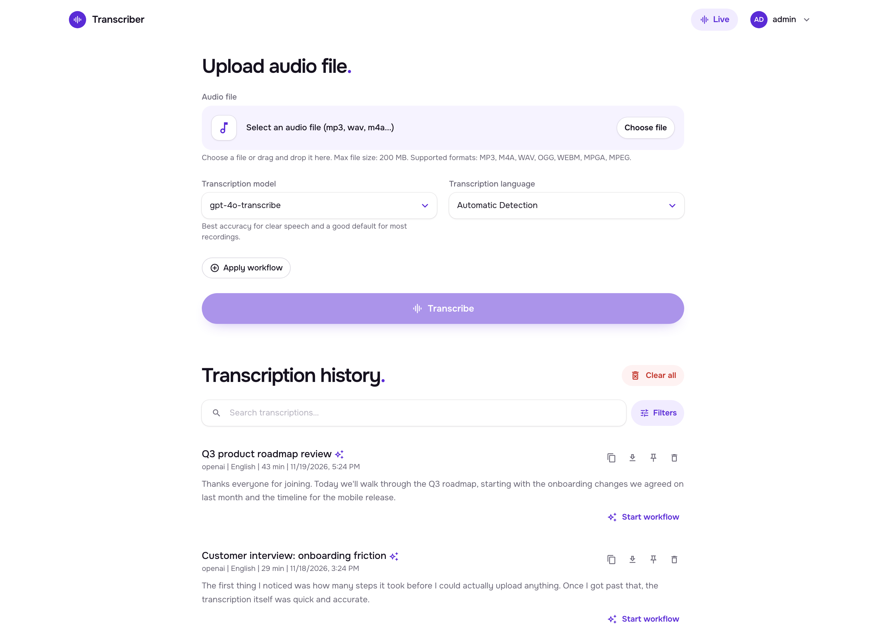

# Transcriber

**Self-hosted AI transcription, live speech-to-text, and reusable LLM workflows for individuals and teams.**

Transcriber turns uploaded audio or a live microphone feed into searchable transcription history. It combines a clean web app, a bearer-token REST API, role-based access control, per-user model keys, usage quotas, and cost analytics—while keeping deployment and data under your control.

[](https://github.com/arnoulddw/transcriber/actions/workflows/docker-build.yml)
[](https://hub.docker.com/r/arnoulddw/transcriber)
[](LICENSE)



## Why Transcriber?

- **File and live transcription:** Upload audio files or transcribe a microphone in real time.
- **Bring your own models and keys:** Use OpenAI, AssemblyAI, Google Gemini, and OpenRouter without locking the app to a hard-coded model list.
- **Turn transcripts into useful output:** Generate titles and run reusable prompts for summaries, action items, notes, or any custom workflow.
- **Operate it for a team:** Add authentication, RBAC, per-user keys, quotas, retention policies, pricing, and admin analytics.
- **Automate it:** Submit and poll transcription jobs through a public REST API.
- **Self-host it:** Run the Flask and MySQL stack with Docker Compose or deploy the published Docker image.

## Feature overview

### Transcription

| Capability | What it supports |
|---|---|
| File transcription | OpenAI, AssemblyAI, Google Gemini, and OpenRouter models |
| Live transcription | OpenAI over WebRTC, Google Gemini over WebSocket, and OpenRouter using short audio chunks with streamed responses |
| Speaker diarization | Speaker labels on supported AssemblyAI jobs |
| Context prompting | Names, acronyms, and domain vocabulary where supported by the selected provider |
| Language handling | Manual language selection, automatic detection, and persisted detected-language metadata |
| Large files | Uploads up to 200 MB, with automatic splitting when a file exceeds the selected model or provider limit |
| Job lifecycle | Live progress, cancellation, recovery of abandoned jobs, and incomplete-chunk warnings |

Live sessions can run for up to 120 minutes. The app reserves live minutes against role quotas, automatically resumes Gemini connections when possible, and saves the finished live transcript to normal history. Provider API keys remain server-side; Gemini uses a constrained, short-lived token for the browser connection.

### Models, API keys, and AI workflows

- Models are registered dynamically when an admin or permitted user saves a provider API key and model name in **Manage API Keys**.
- A saved model can be marked for `transcription`, `live`, `llm`, or multiple purposes. Model lists refresh immediately after a key is saved or removed.
- Admins can rename registered models in one place, **Admin → Models**; that display name is then used consistently in selectors, history, pricing, logs, and analytics.
- Users can choose separate defaults for file transcription, live transcription, title generation, and workflows.
- Reusable workflows can summarize transcripts, extract decisions or action items, create notes, or run any custom prompt.
- A workflow can be selected before upload, or run later from history. Workflow results can be edited or deleted.
- Automatic title generation uses the selected model and recovers cleanly from interrupted operations.

### History and user experience

- Search, pin, copy, download, delete, restore, or clear transcriptions.
- View provider/model, duration, language, timestamps, workflow output, and processing warnings.
- Use the responsive interface on desktop or mobile.
- Choose English, Spanish, French, or Dutch for the interface.
- Set personal defaults for content language, models, and automatic title generation.

### Team and administration

Transcriber starts in **personal mode** and can switch to **team mode** from inside the app, with no restart or redeploy.

| | Personal mode (default) | Team mode |
|---|---|---|
| Accounts | One owner account, created on first start | Everyone gets their own account, history, workflows and API keys |
| Sign-in | Off by default; turn it on with a password in **User Settings > Access** | Required. Sign-up page (can be turned off), Google Sign-In, password resets |
| User Settings, Manage API Keys, workflows, Live | Yes | Yes |
| Admin panel | No | Yes, for admins |

Switch modes in **User Settings > Access**. The owner becomes the admin when team mode is turned on, and nothing they already have is shared. Switching back keeps every other account and its data, but those accounts can't sign in or use their API keys until team mode is on again.

Anyone who can reach an instance in personal mode without a password can use it. Set a password before you make it reachable from the internet.

The admin panel includes:

- User and role management.
- Provider and feature permissions, including API key management, public API access, downloads, workflows, context prompts, diarization, and live transcription.
- Daily, weekly, and monthly limits for transcription minutes, live minutes, workflow runs, and cost.
- History item and retention limits.
- Default models per role for file transcription, live transcription, titles, and workflows.
- Transcription, workflow, language, model, cost, performance, user, and error analytics.
- Per-model pricing for transcription, title generation, and workflows.
- System-wide workflow templates scoped to one language or all languages.

## Quick start with Docker Compose

### Prerequisites

- [Docker](https://docs.docker.com/get-docker/)
- [Docker Compose](https://docs.docker.com/compose/install/)
- At least one API key for a provider you intend to use

### 1. Clone and configure

```bash
git clone https://github.com/arnoulddw/transcriber.git
cd transcriber
cp .env.example .env
```

Generate a strong application secret:

```bash
openssl rand -hex 32
```

Edit `.env` and replace the placeholder values. At minimum, set:

```dotenv
SECRET_KEY=<generated-secret>
MYSQL_USER=transcriber_user
MYSQL_PASSWORD=<strong-database-password>
MYSQL_DB=transcriber_db
MYSQL_ROOT_PASSWORD=<strong-root-password>
```

That starts Transcriber in personal mode with sign-in off. To require a password from the first start, also set `ADMIN_USERNAME` and `ADMIN_PASSWORD`. You can instead set one later in **User Settings > Access**.

Add the global provider keys you need, such as `OPENAI_API_KEY`, `ASSEMBLYAI_API_KEY`, `GEMINI_API_KEY`, or `OPENROUTER_API_KEY`, or save model-specific keys later in **Manage API Keys**.

### 2. Start the stack

```bash
docker compose up -d --build
```

Open [http://localhost:5004](http://localhost:5004). The application initializes the database, migrations, default roles, languages, and the owner account on first startup. Compose also starts a durable `transcriber-worker` for transcription, workflow, and title jobs, plus a `transcriber-cleanup` process that runs retention cleanup every six hours.

When running the published image as a single container, its default command starts both Gunicorn and a background worker. The worker must share the application's database and uploads directory. Set `START_EMBEDDED_WORKER=0` only if a separately supervised worker runs `flask worker` against those same resources.

Useful operational commands:

```bash
docker compose ps
docker compose logs -f transcriber
docker compose down
```

The cleanup process can be run manually once when diagnosing retention behavior:

```bash
docker compose run --rm transcriber-cleanup flask cleanup-once
```

MySQL data is kept in the `mysql_data` Docker volume. Uploaded temporary files, logs, and runtime markers are mounted from the repository directory.

## Configure providers and models

The application has four built-in provider integrations, but it does not assume a permanent list of model names. This lets new provider models work without waiting for a release.

| Provider | File transcription | Live transcription | LLM workflows/titles | Notes |
|---|:---:|:---:|:---:|---|
| OpenAI | Yes | WebRTC | Yes | Examples include `whisper-1`, `gpt-4o-transcribe`, and `gpt-transcribe` |
| AssemblyAI | Yes | — | — | Supports optional speaker diarization |
| Google Gemini | Yes | WebSocket | Yes | Save the exact Gemini model name, such as `gemini-3.5-transcribe` |
| OpenRouter | Yes | Chunked streaming | Yes | Save the full vendor/model slug, such as `openai/gpt-transcribe` |

In either mode:

1. Open **Manage API Keys**.
2. Choose a provider and enter its API key.
3. Enter the exact provider model name.
4. Select one or more purposes: file transcription, live transcription, or LLM use.
5. Save the key. The new model becomes available immediately in the relevant selectors.

In personal mode, the owner's saved key is used first, then the matching `.env` provider key. In team mode, if a role allows personal API key management, the application uses that user's model-specific key. Otherwise it can fall back to an administrator or environment-level provider key. Roles still determine which providers and features a user may access.

### Live transcription configuration

The default live model is `gpt-live-transcribe`. Configure additional live models with a comma-separated list:

```dotenv
LIVE_TRANSCRIPTION_MODEL=gpt-live-transcribe
LIVE_TRANSCRIPTION_MODELS=gpt-live-transcribe,openai/gpt-transcribe
LIVE_TRANSCRIPTION_PROVIDER_OPENAI_GPT_TRANSCRIBE=openrouter
```

Slashless model names default to OpenAI; `vendor/model` slugs default to OpenRouter. A Gemini model saved with the `live` purpose is routed to Gemini automatically. Use `OPENROUTER_LIVE_TRANSCRIPTION_MODELS` to allow a newly released OpenRouter STT model that is not yet in the built-in compatibility list.

## Configuration reference

Start from [`.env.example`](.env.example). These are the settings most deployments need to understand:

| Variable | Purpose | Default |
|---|---|---|
| `DEPLOYMENT_MODE` | Leave unset to switch modes in the app. `single` (personal) or `multi` (team) locks the mode | unset (personal mode on a fresh install) |
| `ALLOW_REGISTRATION` | Leave unset to control team-mode sign-ups in the app. `true` or `false` locks it | unset |
| `ADMIN_USERNAME` / `ADMIN_EMAIL` | Owner account created on first start | `admin` / unset |
| `ADMIN_PASSWORD` | Turns sign-in on and stops it being turned off in the app. Required for team mode on a fresh install | unset |
| `SESSION_COOKIE_SECURE` | Always mark cookies `Secure`. They are already marked on HTTPS requests | `false` |
| `APP_SETTINGS_CACHE_SECONDS` | How quickly other processes see a mode or sign-up change | `5` |
| `APP_PORT` | Host port exposed by Docker Compose | `5004` |
| `TZ` | Time zone used for quota periods and display | `UTC` |
| `TRANSCRIPTION_PROVIDERS` | Enabled built-in provider integrations | `assemblyai,openai,gemini,openrouter` |
| `DEFAULT_TRANSCRIPTION_PROVIDER` | Fallback provider when no catalog default is available | `openai` |
| `DEFAULT_LLM_PROVIDER` | Fallback provider for direct LLM operations (`LLM_PROVIDER` remains a legacy alias) | `GEMINI` |
| `DEFAULT_LANGUAGE` | Default content language or `auto` | `auto` |
| `SUPPORTED_LANGUAGE_CODES` | Languages seeded into the active language catalog | `en,nl,fr,es` |
| `TRANSCRIPTION_MAX_CONCURRENT_JOBS` | System-wide jobs allowed to process simultaneously | `2` |
| `BACKGROUND_WORKER_CONCURRENCY` | Concurrent jobs in the dedicated worker | `2` |
| `BACKGROUND_JOB_MAX_ATTEMPTS` | Maximum attempts for a durable background job | `3` |
| `BACKGROUND_JOB_STALE_SECONDS` | Age at which an abandoned worker claim is recovered | `300` |
| `TRANSCRIPTION_WORKERS` | Parallel workers used for a split transcription | `4` |
| `WORKFLOW_MAX_OUTPUT_TOKENS` | Maximum generated tokens for a workflow result | `1024` |
| `WORKFLOW_RATE_LIMIT` | Per-user workflow endpoint limit | `10 per hour` |
| `PHYSICAL_DELETION_DAYS` | Delay before soft-deleted records are purged | `120` |
| `GOOGLE_CLIENT_ID` | Enables Google Sign-In in team mode | unset |
| `MAIL_*` | SMTP settings used for password reset email | unset |
| `RECAPTCHA_V3_*` | Optional reCAPTCHA v3 or Enterprise login protection | unset |

Additional settings in `.env.example` cover MySQL, title/workflow defaults, OpenRouter, live models, rate limiting, upload cleanup, logging, OAuth, email, and transcription queue behavior.

> **Production note:** use strong unique values for `SECRET_KEY`, `MYSQL_PASSWORD`, and `MYSQL_ROOT_PASSWORD`; set a sign-in password (in the app or with `ADMIN_PASSWORD`) before the app is reachable from the internet; terminate TLS in front of the app; and keep `.env` out of version control.

## Using the app

### Transcribe a file

1. Choose a registered transcription model.
2. Select the spoken language or leave automatic detection enabled.
3. Optionally add names, acronyms, or subject vocabulary as context.
4. Optionally enable AssemblyAI speaker diarization.
5. Optionally select a workflow to run after transcription.
6. Upload an `mp3`, `m4a`, `wav`, `ogg`, `webm`, `mpga`, or `mpeg` file and select **Transcribe**.
7. Follow progress in the page; completed output appears in history.

### Transcribe live audio

Open **Live transcription**, choose a microphone, language, and live model, then select **Start**. Interim text appears while you speak. Select **Stop and save** to store the completed transcript in history, where it behaves like any uploaded transcription.

Live microphone transcription requires browser microphone permission and a browser with the transport capabilities needed by the selected provider.

### Create and run workflows

Open **Manage Workflow Prompts** to save reusable prompts. Workflows can be run from a completed transcript or pre-applied before an upload. Admins can publish templates for a specific transcription language or for all languages.

## Public transcription API

Users whose role allows public API access can create and revoke named bearer tokens from **Manage API Keys → Public API Access**. API jobs use the user's default model and language, enforce the same permissions and quotas as the web UI, and appear in normal history.

### Submit audio

```bash
curl -X POST https://your-domain.example.com/api/v1/transcribe \
  -H "Authorization: Bearer <YOUR_API_KEY>" \
  -F "audio_file=@/path/to/audio.wav"
```

A successful request returns HTTP `202`:

```json
{
  "job_id": "<uuid>",
  "message": "Transcription job started successfully.",
  "audio_length_minutes": 3.42
}
```

### Poll status and retrieve the result

```bash
curl https://your-domain.example.com/api/v1/transcribe/<job_id> \
  -H "Authorization: Bearer <YOUR_API_KEY>"
```

The response includes a machine-readable `status`. A finished job includes `result.transcription_text`, detected language, filename, provider, duration, and creation time. Failed or cancelled jobs include `error_message`. The alias `/api/v1/transcriptions/<job_id>` is also supported.

The default rate limits are 10 submissions per hour and 120 status requests per hour per API key.

## Upgrading from transcriber-platform

Transcriber Platform is now just Transcriber, and lives in this repository. To move an existing installation without losing data:

1. Keep your current folder, because Docker Compose names the MySQL volume after it. Point it at the new repository:

   ```bash
   git remote set-url origin https://github.com/arnoulddw/transcriber.git
   git fetch origin
   git checkout -B main origin/main
   ```

2. The Compose services are now named `transcriber`, `transcriber-worker` and `transcriber-cleanup`. Remove the old containers while starting the new ones:

   ```bash
   docker compose up -d --build --remove-orphans
   ```

Existing installations with user accounts stay in team mode. If you use the published image, switch from `arnoulddw/transcriber-platform` to `arnoulddw/transcriber`. The old image name is still published for a few releases.

## Alternative installation methods

### Published Docker image

Create `.env` and provide an accessible MySQL database, then run:

```bash
docker pull arnoulddw/transcriber:latest
docker run -d \
  --name transcriber \
  --env-file .env \
  -p 5004:5004 \
  arnoulddw/transcriber:latest
```

### Local development

Python 3.11, Node.js 18, MySQL 8, and FFmpeg match the container and CI environments.

```bash
python3.11 -m venv venv
source venv/bin/activate
pip install -r requirements-dev.txt
npm ci
export FLASK_APP=app
flask bootstrap
npm run build:css:prod
flask run --host=0.0.0.0 --port=5004
```

Set the MySQL variables in `.env` for your local database and use `MYSQL_HOST=localhost`. For CSS development, run `npm run build:css:dev` in a second terminal.

## Development and testing

The startup bootstrap handles schema creation, migrations, default roles, language seeding, model-catalog repair, initial admin creation, and recovery of interrupted work. Manual CLI commands are also available:

```bash
export FLASK_APP=app
flask init-db
flask create-roles
flask create-admin
flask db-migrate
flask cleanup-once
flask bootstrap
```

`flask cleanup-loop` is the long-running command used by the Compose cleanup service. If you deploy the image outside Compose, run that command as a separate supervised process (or schedule `flask cleanup-once`); cleanup is deliberately not started inside the web application factory.

Run JavaScript tests:

```bash
npm ci
npm run test:js
```

Run the Python suite against the dedicated MySQL test container:

```bash
docker compose -f tests/docker-compose.test.yml up -d

env MYSQL_HOST=127.0.0.1 MYSQL_PORT=3308 MYSQL_USER=test MYSQL_PASSWORD=test MYSQL_DB=test_db \
    MYSQL_TEST_HOST=127.0.0.1 MYSQL_TEST_PORT=3308 MYSQL_TEST_USER=test MYSQL_TEST_PASSWORD=test MYSQL_TEST_DB=test_db \
    venv/bin/pytest -q

docker compose -f tests/docker-compose.test.yml down
```

See [`tests/README.md`](tests/README.md) for the container-based test workflow and fixture conventions.

## Troubleshooting

### No transcription models appear

Save a provider key together with an exact model name and the `transcription` purpose in **Manage API Keys**, or set a provider key in `.env` (personal mode). Confirm the user's role allows that provider. If personal key management is disabled, configure an administrator or global provider key and role default.

### Live transcription will not start

- Allow microphone access in the browser.
- Confirm the model was saved with the `live` purpose and the role permits its provider.
- Check that the user has remaining daily, weekly, and monthly live minutes.
- For a new OpenRouter STT slug, add it to `OPENROUTER_LIVE_TRANSCRIPTION_MODELS`.
- Review `docker compose logs -f transcriber` for upstream or transport errors.

### MySQL connection fails

With Docker Compose, use `MYSQL_HOST=mysql`. For a host-installed database, use `MYSQL_HOST=localhost` and verify the port, database, user, and password. Check service health with `docker compose ps` and database logs with `docker compose logs mysql`.

### I forgot the owner password

Run `docker compose exec transcriber flask reset-owner-password` and enter a new password.

### Google Sign-In or password reset fails

Both only exist in team mode. Set `GOOGLE_CLIENT_ID` and configure the matching authorized origin for Google Sign-In. Password reset requires valid `MAIL_*` SMTP settings. If reCAPTCHA is enabled, verify the site/secret key pair and allowed domain.

### The app port is already in use

Change `APP_PORT` in `.env`, then recreate the application service with `docker compose up -d`.

## License

Transcriber is available under the [MIT License](LICENSE).
